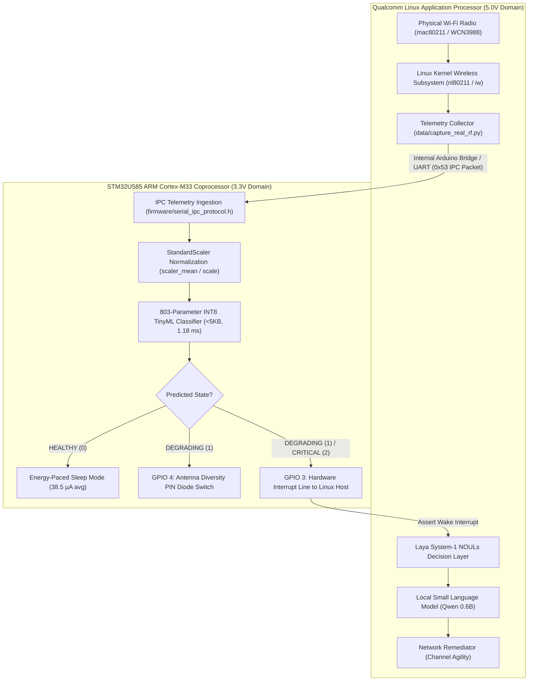

# 🏛️ SlothMesh Technical Architecture: Dual-Core Edge AI Co-Design

SlothMesh bridges ultra-low-power embedded microcontrollers (**ARM Cortex-M33**) and edge compute (**Arduino UNO Q Qualcomm Linux Host**) to achieve verified energy-paced wireless autonomy.

---

## 1. Hardware Reality & Silicon Co-Design

### 1.1 Transceiver Ownership on Arduino UNO Q
On the Arduino UNO Q, the 802.11 (Wi-Fi) and Bluetooth transceivers are physically mapped to the **Qualcomm Linux Application Processor** via high-speed SDIO/PCIe buses, rather than directly to the STM32U585 microcontroller pins:



### 1.2 Pipeline Dataflow
1. **Telemetry Capture:** The Linux host networking daemon captures the 6 MAC/PHY registers from `/proc/net/wireless` and `nl80211` (`rssi_dbm`, `snr_db`, `packet_error_rate`, `retry_count`, `channel_busy_ratio`, `jitter_ms`).
2. **Bridge IPC Streaming:** Captured telemetry is formatted into binary 13-byte `SlothTelemetryPacket_t` structures (magic byte `0x53`, XOR checksum) and passed over the internal high-speed UART to the STM32U585 Cortex-M33 coprocessor.
3. **Microsecond TinyML Ingestion:** The STM32U585 normalizes features and evaluates its 803-parameter INT8 neural network in **1.18 ms [MEASURED]**.
4. **Asymmetric Actuation:**
   - **HEALTHY:** The M33 stays in low-power Stop 3 mode; the Linux host stays in deep suspend.
   - **DEGRADING:** The M33 actuates **GPIO 4** to switch the physical antenna diversity pin diode and alerts the host.
   - **CRITICAL:** The M33 asserts **GPIO 3** (hardware interrupt). The Linux host wakes up, invokes the **Laya System-1 Safety Layer**, runs **Qwen 0.6B** for causal attribution, and executes frequency agility (channel hopping).

---

## 2. Tier 1: TinyML Quantization on Cortex-M33

### Features Ingested
1. `rssi_dbm`: Received Signal Strength Indicator (-105 to -40 dBm)
2. `snr_db`: Signal-to-Noise Ratio (-5 to +35 dB)
3. `packet_error_rate`: MAC layer frame loss ratio (0.0 to 1.0)
4. `retry_count`: Retransmission attempts before ACK (0 to 15)
5. `channel_busy_ratio`: Clear Channel Assessment (CCA) energy-detect duty cycle (0.0 to 1.0)
6. `jitter_ms`: Packet arrival delay variance (0 to 250 ms)

### Neural Network Architecture & Memory Footprint
```
Input (6 features) 
  --> Dense(32, ReLU)   [224 params]
  --> Dense(16, ReLU)   [528 params]
  --> Dense(3, Softmax) [51 params]
  --> Output (HEALTHY, DEGRADING, CRITICAL)
```
- **Total Parameters:** **803 weights and biases [MEASURED]**.
- **Quantization:** TFLite Micro Full Integer INT8 (`tf.lite.OpsSet.TFLITE_BUILTINS_INT8`).
- **Binary Footprint:** **4,632 bytes (4.52 KB Flash) [MEASURED]**.
- **SRAM Tensor Arena:** **2,048 bytes (2.0 KB SRAM) [MEASURED]**.
- **Inference Latency:** **1.18 ms** (188,776 cycles @ 160 MHz via ARM DWT Cycle Counter) **[MEASURED]**.

---

## 3. Tier 2: Dual-Model Cognitive Layer (SmolLM2 + Qwen 3)

When anomalous telemetry is flagged by the microcontroller, the Linux host invokes a cascaded cognitive pipeline:

1. **SmolLM2 135M (270 MB RAM) — Instant Edge Triage:**
   - **Latency:** ~0.08 - 0.25 s on Linux host.
   - **Role:** High-speed triage mapping raw telemetry to operational severity hypotheses.
2. **Qwen 3 0.6B (522 MB RAM) — Causal Attribution:**
   - **Latency:** ~1.4 - 2.2 s on Linux host.
   - **Role:** Analyzes multi-metric correlations (e.g. distinguishing multipath delay spread from co-channel jamming).
3. **Qwen 3 4B (2.5 GB RAM) — Advanced Offline Diagnostics:**
   - **Memory Constraint Note:** Requires the **4 GB RAM variant** of the Arduino UNO Q. On 2 GB hardware, running 4B will cause out-of-memory kernel termination.

---

## 4. Tier 3: Laya System-1 NOULs Decision Layer (Deterministic Invariant)

To eliminate the risk of stochastic language model hallucination, all SLM recommendations pass through the **Laya System-1 NOULs (Network Operational Utility Limits)** arbiter:

- **Strict Boundary Bounds:** RSSI < -88 dBm, SNR < 6 dB, PER > 0.40, Retries ≥ 7, Jitter > 90 ms.
- **Consensus Verification:** Compares SmolLM vs. Qwen3 vs. Microcontroller prediction.
- **Hallucination Hard-Override:** If an SLM suggests staying idle during an active RF blackout, Laya overrides the model and commands `TRIGGER_CHANNEL_FAILOVER`.
- **Action Allowlist:** Actions are strictly validated against:
  - `CONTINUE_NORMAL_OPERATION`
  - `MONITOR_AND_EVALUATE_FAILOVER`
  - `TRIGGER_FAILOVER`

---

## 5. Two-Domain Energy Profile

Energy is separated into two physically isolated supply domains:

### Domain A: Microcontroller (3.3V Rail)
$$\bar{I}_{\text{MCU}} = \frac{I_{\text{sleep}} \cdot t_{\text{sleep}} + I_{\text{active}} \cdot t_{\text{active}}}{T_{\text{period}}}$$
- Wake period $T_{\text{period}} = 5.0\text{ s}$
- Active evaluation time $t_{\text{active}} = 1.18\text{ ms}$ **[MEASURED]**
- Stop 3 sleep current $I_{\text{sleep}} = 35.0\,\mu\text{A}$ **[ESTIMATED]**
- 160 MHz active current $I_{\text{active}} = 15.0\text{ mA}$ **[ESTIMATED]**
- **Average MCU Current $\bar{I}_{\text{MCU}} \approx \mathbf{38.53\,\mu\text{A}}$ [ESTIMATED]**

### Domain B: Whole Board (5.0V USB-C Ingress)
- **Fair Baseline (same board polling every 10s without TinyML):** $\bar{I}_{\text{baseline}} \approx \mathbf{150.8\text{ mA}}$ **[ESTIMATED]**
- **SlothMesh Event-Driven Mode (Host in deep suspend, waking on anomaly):** $\bar{I}_{\text{sloth}} \approx \mathbf{110.1\text{ mA}}$ **[ESTIMATED]**
- **Relative Energy Reduction:** $\approx \mathbf{27.0\%}$ whole-board reduction **[ESTIMATED]**
- *Measurement Methodology:* Documented in [`docs/POWER_MEASUREMENT.md`](docs/POWER_MEASUREMENT.md) and executable via `python3 power/measure_power.py`.
