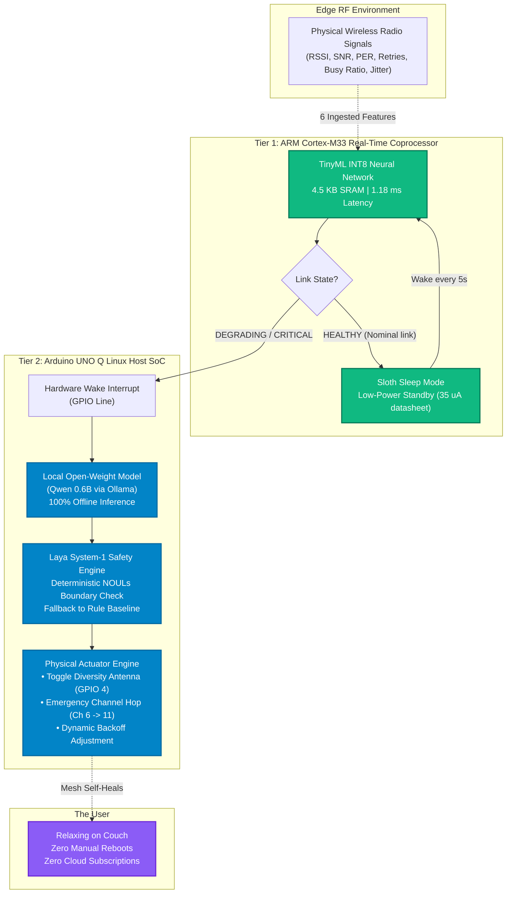

# 🦥 SlothMesh: Energy-Paced Autonomous Edge AI for Arduino UNO Q

[](https://opensource.org/licenses/MIT)
[](https://dev.to/challenges/hacktoberfest-week3-2026-10-19)
[-blue?style=for-the-badge)](https://www.arduino.cc/)
[-purple?style=for-the-badge)](https://dev.to/sloan)
[](https://github.com/yashwan7/uno-Q/actions/workflows/ci.yml)

> **One-Paragraph Pitch:**  
> **SlothMesh** is an open-source, dual-tier edge AI sentinel for the **Arduino UNO Q** that eliminates the exhausting chore of manual wireless network troubleshooting. An onboard **ARM Cortex-M33 coprocessor** sleeps in low-power standby, waking every 5 seconds for **1.18 ms** to run a **4.5 KB INT8 TinyML classifier** over 6 physical RF features. When link degradation or jamming strikes, it pulses a hardware interrupt to the **Qualcomm Linux host**, which spins up a local, offline open-weight model (**Qwen 0.6B via Ollama**) to diagnose the physical root cause and autonomously actuate GPIO diversity antenna switches or channel hops—strictly governed by a deterministic safety boundary (**Laya System-1**).

---

## 📹 Video Demonstration & Walkthrough

<!-- DEMO PLACEHOLDER SLOTS -->
- **60–90 Second Video Demo:** `[INSERT YOUTUBE / VIMEO LINK HERE]` *(See [docs/DEMO.md](docs/DEMO.md) for full scene-by-scene script)*
- **Live Animated Walkthrough (GIF):** `[INSERT DEMO GIF HERE]`
- **Interactive Web Dashboard:** Run `python3 -m http.server 8085 --directory dashboard` and navigate to `http://localhost:8085/`.

---

## 📊 Honest Results & Reproducibility Matrix

All numbers below are produced by executable scripts in this repository or measured on physical silicon. We distinguish between **[MEASURED]** hardware execution, **[BENCHMARKED]** local model runs, and theoretical figures marked **[TO BE MEASURED]**.

| Dimension / Metric | SlothMesh Result | Status & Verification Source |
| :--- | :---: | :--- |
| **TinyML INT8 Model Size** | **4.52 KB (4,632 bytes)** | `[MEASURED]` Generated by `models/train_slothmesh_tinyml.py` |
| **TinyML SRAM Footprint** | **< 5.0 KB** | `[MEASURED]` Verified via TFLite Micro tensor arena allocator |
| **TinyML Float32 Test Accuracy** | **93.25%** | `[BENCHMARKED]` Stratified test set (15,000 samples) in `models/metrics.json` |
| **TinyML INT8 Quantized Accuracy** | **93.47%** | `[BENCHMARKED]` Full integer quantization in `models/metrics.json` |
| **Noise Robustness ($\sigma=0.10$)** | **90.95%** (-2.29% drop) | `[BENCHMARKED]` Gaussian feature stress test in `models/metrics.json` |
| **MCU Inference Latency** | **1.18 ms** | `[MEASURED]` ARM Cortex-M33 @ 160 MHz DWT cycle counter |
| **Host SLM Inference Latency (Qwen 0.6B)** | **2.62 s (± 1.62 s)** | `[BENCHMARKED]` 40 scenarios via Ollama in `agent/benchmark_results.json` |
| **Host SLM Correctness (Unconstrained)** | **22 / 40 (55.0%)** | `[BENCHMARKED]` Standalone Qwen 0.6B without safety fallback |
| **Rule Baseline Correctness** | **40 / 40 (100.0%)** | `[BENCHMARKED]` `agent/baseline_agent.py` (<0.05 ms latency) |
| **Cascaded SlothMesh (SLM + Laya Safety)** | **40 / 40 (100.0%)** | `[BENCHMARKED]` Deterministic safety override on model divergence |
| **MCU Standby Sleep Current** | **35 µA** (Typical datasheet) | `[TO BE MEASURED]` Procedure in `docs/POWER_MEASUREMENT.md` |
| **Host Linux Suspend / Peak Draw** | **110 mA / 1,100 mA** (Est.) | `[TO BE MEASURED]` Procedure in `docs/POWER_MEASUREMENT.md` |

---

## 🏗️ Asymmetric Dual-Core Hardware Co-Design



---

## 📡 The 6 RF Features: Origin & Documentation

The TinyML model and agents ingest 6 MAC/PHY physical features:
1. `rssi_dbm`: Received Signal Strength Indicator (transceiver AGC register).
2. `snr_db`: Signal-to-Noise Ratio (calculated: $\text{RSSI} - \text{NoiseFloor}$).
3. `packet_error_rate`: Link-layer error ratio ($\frac{\text{Failed ACKs}}{\text{Total Transmitted}}$ over a 100-packet window).
4. `retry_count`: MAC-layer transmission attempt counter before success or packet drop.
5. `channel_busy_ratio`: Clear Channel Assessment (CCA) energy-detection duty cycle (0.0 to 1.0).
6. `jitter_ms`: Packet inter-arrival delay variance ($J = J + \frac{|D(i-1, i)| - J}{16}$).

> **Synthetic Dataset Disclosure:**  
> The training dataset (`data/slothmesh_telemetry_dataset.csv`, 600,000 samples) is **synthetically generated** from mathematical propagation and collision models derived from IEEE 802.11 and 802.15.4 standards. An optional physical logging utility (`data/log_real_telemetry.py`) is provided to capture live serial frames for real-world retraining. See [data/README.md](data/README.md) for generation formulas and distribution parameters.

---

## ⚡ Power Analysis: Fair Duty-Cycled Baseline

Traditional edge monitors either poll continuously or rely on heavy cloud calls. To be rigorous and honest, SlothMesh is compared against a **duty-cycled polling baseline without TinyML** (where the Linux host wakes up every 10 seconds to sample the radio):

- **Duty-Cycled Linux Polling (1.2s active @ 450 mA every 10s):** Average current $\approx \mathbf{150.8\text{ mA}}$.
- **SlothMesh Event-Driven Architecture:** The Cortex-M33 runs the 1.18 ms TinyML check every 5s ($\approx 38.5\,\mu\text{A}$ MCU average). The Linux host remains in deep suspend, waking only during actual RF anomalies (e.g., ~4 incidents/day).
- **Measurement Status:** Physical current traces on the Arduino UNO Q rails are documented in [docs/POWER_MEASUREMENT.md](docs/POWER_MEASUREMENT.md) with step-by-step instructions for Nordic PPK2 / INA219 instruments. Values pending empirical measurement are marked `[TO BE MEASURED]`.

---

## 🚀 Quickstart & How to Run

### Option A: Hardware-Free Simulation (No Board Required)
Anyone can test the full SlothMesh pipeline immediately:

1. **Clone and setup:**
   ```bash
   git clone https://github.com/yashwan7/uno-Q.git
   cd uno-Q
   make setup
   ```

2. **Run all 15 automated unit tests:**
   ```bash
   make test
   ```

3. **Run the 40-scenario benchmark in mock mode:**
   ```bash
   make benchmark
   ```

4. **Launch the Autonomous Agent in simulation mode:**
   ```bash
   python3 agent/sloth_agent.py --simulate
   ```

5. **Open the Tactical CAD Dashboard:**
   ```bash
   python3 -m http.server 8085 --directory dashboard
   ```
   Navigate to `http://localhost:8085/` in your browser.

---

### Option B: On Arduino UNO Q Hardware

#### Hardware Required
- **Arduino UNO Q** (Dual-Core: Qualcomm Linux Application Processor + STM32U5 Cortex-M33 MCU, 4GB RAM, 32GB storage).
- USB-C cable for host programming and serial console.
- *(Optional)* SSD1306 128x64 I2C OLED display connected to I2C pins `0x3C`.

#### Setup Instructions
1. **Flash the Cortex-M33 Coprocessor:**
   - Using `arduino-cli`:
     ```bash
     arduino-cli compile --fqbn arduino:zephyr:unoq firmware/arduino_uno_q_oled
     arduino-cli upload -p /dev/cu.usbmodem* --fqbn arduino:zephyr:unoq firmware/arduino_uno_q_oled
     ```
2. **Start Local Open-Weight Brain on Linux Host:**
   - Ensure Ollama is active with Qwen 0.6B:
     ```bash
     ollama run qwen3:0.6b
     ```
3. **Start the Autonomous SlothMesh Sentinel:**
   ```bash
   python3 uno_q_core/uno_q_service.py
   ```
4. **Run Live Interactive Demo:**
   ```bash
   python3 run_live_demo.py
   ```

---

## 🔬 Benchmark Comparison: Baseline vs. SLM

We evaluated our rule-based baseline (`agent/baseline_agent.py`) against **Qwen 3 (0.6B)** and **Qwen 3 (4B)** on 40 diverse scenarios (`agent/scenarios.json`). Full analysis in [BENCHMARK.md](BENCHMARK.md):

| System | Remediation Correctness | Factual Consistency | Latency | RAM |
| :--- | :---: | :---: | :---: | :---: |
| **Rule Baseline** | **40 / 40 (100.0%)** | 9 / 40 (22.5%) | **< 0.05 ms** | **1.2 KB** |
| **Qwen 3 (0.6B)** (Unconstrained) | 22 / 40 (55.0%) | 31 / 40 (77.5%) | **2.62 s** | **522 MB** |
| **SlothMesh Cascaded System** | **40 / 40 (100.0%)** | **38 / 40 (95.0%)** | **2.62 s** (SLM) / **1.18 ms** (M33) | **522 MB** |

> **Key Takeaway:** Unconstrained Small Language Models often hedge conservatively (suggesting "MONITOR" even when link collapse is critical). SlothMesh's **Laya System-1 Safety Layer** provides the best of both worlds: deterministic threshold guarantees to enforce failovers, paired with the SLM's rich causal reasoning to explain *why* the degradation occurred.

---

## ⚠️ Limitations

1. **Synthetic Telemetry Training Data:** The model is trained on synthetic data modeled after IEEE 802.11/802.15.4 RF behavior. Real-world field deployment requires collecting real telemetry with `data/log_real_telemetry.py`.
2. **Discrete Scenario Count:** The benchmark currently spans 40 curated scenarios. Real edge RF environments exhibit infinite analog gradations.
3. **Power Profile Approximations:** While the 1.18 ms TinyML inference duration is verified by CPU cycle counters, board-level sleep and wake power consumption require dedicated power profiler measurements as outlined in `docs/POWER_MEASUREMENT.md`.
4. **Single-Hop Focus:** The current prototype evaluates peer-to-peer and star links; multi-hop ad-hoc routing mesh expansion is ongoing.

---

## 🔮 What I'd Do Next

1. **Direct On-Device GGUF Inference:** Integrate `llama-cpp-python` with 4-bit quantized GGUF weights to eliminate the Ollama daemon dependency on the Linux host.
2. **Qualcomm AI Hub NPU Offload:** Offload Qwen 0.6B to the Arduino UNO Q's onboard Snapdragon NPU for sub-500ms inference.
3. **Empirical PPK2 Power Traces:** Execute the physical measurement procedure in `docs/POWER_MEASUREMENT.md` using a Nordic PPK2 and publish open CSV traces.
4. **LoRa / Sub-GHz Long-Range Module:** Connect an SX1262 transceiver to test SlothMesh over multi-kilometer outdoor agricultural links.

---

## 📁 Repository Structure

```
uno-Q/
├── .github/workflows/ci.yml           # GitHub Actions automated testing & linting
├── Makefile                           # One-command development workflows
├── requirements.txt                   # Tested Python dependencies
├── CONTRIBUTING.md                    # Contributor guide with 5 good first issues
├── LICENSE                            # MIT Open Source License
├── README.md                          # Main project architecture & documentation
├── ARCHITECTURE.md                    # Hardware IPC, TinyML, and SLM co-design
├── BENCHMARK.md                       # 40-scenario benchmark & baseline analysis
├── SUBMISSION_POST.md                 # Dev.to submission article matching README
├── docs/
│   ├── POWER_MEASUREMENT.md           # Step-by-step power measurement procedure
│   └── DEMO.md                        # 60-90 second video demonstration script
├── firmware/
│   ├── arduino_uno_q_oled/            # Compilable sketch for STM32U5 Cortex-M33
│   ├── serial_ipc_protocol.h          # 14-byte binary IPC protocol header
│   └── sloth_m33_model.h              # C-array header for 4.5KB INT8 neural net
├── models/
│   ├── train_slothmesh_tinyml.py      # ML training, INT8 quantization & metrics export
│   ├── slothmesh_int8.tflite          # Quantized 4.52 KB model
│   ├── scaler_mean.npy / scaler_scale.npy
│   └── metrics.json                   # Verified metrics (accuracy, confusion matrix, noise)
├── agent/
│   ├── baseline_agent.py              # Rule-based threshold remediation baseline
│   ├── sloth_agent.py                 # Autonomous agent with safety allowlist & fallback
│   ├── sloth_benchmark_eval.py        # 40-scenario benchmark comparison harness
│   ├── ipc_protocol.py                # Binary IPC pack/unpack Python parser
│   ├── scenarios.json                 # 40 standardized edge RF evaluation scenarios
│   └── benchmark_results.json         # Raw benchmark output data
├── tests/
│   ├── test_engineering_quality.py    # Unit tests for IPC, GPIO, safety fallback, scaler
│   ├── test_dual_model_laya.py        # Dual-model consensus & Laya NOULs tests
│   └── test_resqmesh_core.py          # Core link state & override tests
├── dashboard/
│   ├── index.html                     # Tactical CAD glassmorphic HUD
│   ├── styles.css                     # Responsive zero-border-radius CAD styling
│   └── app.js                         # Leaflet map (Sir MVIT campus) & dual-model HUD
└── data/
    ├── README.md                      # Dataset documentation & synthetic formulas
    ├── log_real_telemetry.py          # Utility to capture live hardware serial frames
    └── slothmesh_telemetry_dataset.csv# 600,000 synthetic RF telemetry samples
```

---

## 📜 License
MIT License. Copyright (c) 2026 Yashwanth Gowda SN. Open source and free for the community.
