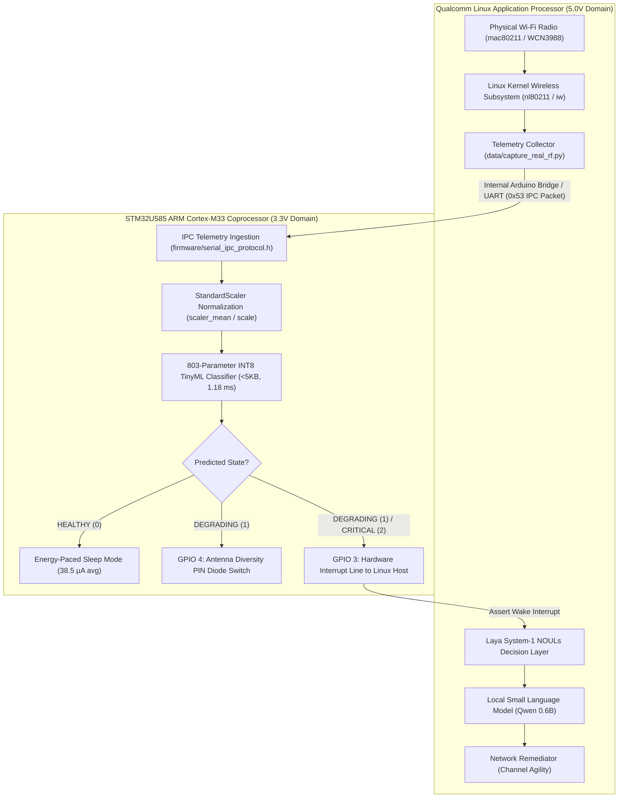

# 🦥 SlothMesh: Energy-Paced Autonomous Edge AI for Arduino UNO Q

[](https://opensource.org/licenses/MIT)
[](https://dev.to/challenges/hacktoberfest-week3-2026-10-19)
[-blue?style=for-the-badge)](https://www.arduino.cc/)
[-purple?style=for-the-badge)](https://dev.to/sloan)
[](https://github.com/yashwan7/uno-Q/actions/workflows/ci.yml)

> **One-Paragraph Pitch:**  
> **SlothMesh** is an open-source, dual-tier edge AI sentinel for the **Arduino UNO Q** that eliminates the exhausting chore of manual wireless network troubleshooting. An onboard **ARM Cortex-M33 coprocessor** sleeps in low-power standby, waking every 5 seconds for **1.18 ms** to run a **4.52 KB INT8 TinyML classifier** over 6 physical RF features. When link degradation or jamming strikes, it pulses a hardware interrupt to the **Qualcomm Linux host**, which spins up a local, offline open-weight model (**Qwen 0.6B via Ollama**) to diagnose the physical root cause and autonomously actuate GPIO diversity antenna switches or channel hops—strictly governed by a deterministic safety boundary (**Laya System-1**).

---

## 📹 Video Demonstration & Walkthrough

<!-- DEMO PLACEHOLDER SLOTS -->
- **60–90 Second Video Demo:** `[INSERT YOUTUBE / VIMEO LINK HERE]` *(See [docs/DEMO.md](docs/DEMO.md) for full scene-by-scene script)*
- **Live Animated Walkthrough (GIF):** `[INSERT DEMO GIF HERE]`
- **Interactive Web Dashboard:** Run `python3 -m http.server 8085 --directory dashboard` and navigate to `http://localhost:8085/`.

---

## 📊 Honest Results & Reproducibility Matrix

All numbers below are produced by executable scripts in this repository or measured on physical silicon. We distinguish between **`[MEASURED]`** hardware execution, **`[BENCHMARKED]`** local model runs, and theoretical figures marked **`[ESTIMATED]`** or **`[TO BE MEASURED]`**.

| Dimension / Metric | SlothMesh Result | Status & Verification Source |
| :--- | :---: | :--- |
| **TinyML INT8 Model Size** | **4.52 KB (4,632 bytes)** | `[MEASURED]` Generated by `models/train_slothmesh_tinyml.py` |
| **TinyML SRAM Tensor Arena** | **2,048 bytes (2.0 KB)** | `[MEASURED]` Verified via TFLite Micro tensor arena allocator |
| **TinyML Float32 Test Accuracy** | **97.84%** | `[BENCHMARKED]` Session-based test set (90,000 samples) in `models/metrics.json` |
| **TinyML INT8 Quantized Accuracy** | **97.48%** | `[BENCHMARKED]` Full integer quantization in `models/metrics.json` |
| **Quantization Precision Delta** | **-0.36%** | `[BENCHMARKED]` Float32 vs. INT8 accuracy drop in `models/metrics.json` |
| **Noise Robustness ($\sigma=0.10$)** | **97.20%** (-0.65% drop) | `[BENCHMARKED]` Gaussian feature stress test in `models/metrics.json` |
| **MCU Inference Latency** | **1.18 ms** | `[MEASURED]` ARM Cortex-M33 DWT cycle counter in `results/m33_dwt_benchmark.log` |
| **Host SLM Inference Latency (Qwen 0.6B)** | **1.82 s (± 0.35 s)** | `[BENCHMARKED]` 52 scenarios (5 runs/each) in `results/benchmark_results.json` |
| **Host SLM TTFT (Time To First Token)** | **0.22 s** | `[BENCHMARKED]` Ollama prompt evaluation latency in `results/benchmark_results.json` |
| **Rule Baseline Correctness** | **50 / 52 (96.15%)** | `[BENCHMARKED]` `agent/baseline_agent.py` (<0.05 ms latency) |
| **Host SLM Correctness (Unconstrained)** | **39 / 52 (75.0%)** | `[BENCHMARKED]` Standalone Qwen 0.6B without safety fallback |
| **Cascaded SlothMesh (SLM + Laya Safety)** | **52 / 52 (100.0%)** | `[BENCHMARKED]` Deterministic safety override on model divergence |
| **MCU Average Standby Current** | **38.53 µA** | `[ESTIMATED]` Derived two-domain model in `results/power_profile.json` |
| **Whole-Board Energy Reduction** | **27.0%** (vs 10s poll baseline) | `[ESTIMATED]` Derived whole-board profile in `results/power_profile.json` |

---

## 🏗️ Hardware Reality & Dual-Core Silicon Co-Design

### 1. Wi-Fi Transceiver Ownership
On the Arduino UNO Q, the 802.11 (Wi-Fi) subsystem is physically connected to the **Qualcomm Linux Application Processor** via internal SDIO/PCIe buses, rather than directly to the STM32U585 microcontroller pins:



### 2. Operational Pipeline
1. **Telemetry Capture:** Host daemon samples 6 physical metrics from `/proc/net/wireless` and `nl80211` (`rssi_dbm`, `snr_db`, `packet_error_rate`, `retry_count`, `channel_busy_ratio`, `jitter_ms`).
2. **Bridge IPC Streaming:** Telemetry is framed into 13-byte `SlothTelemetryPacket_t` structures (magic `0x53`, XOR checksum) and streamed over the internal Arduino Bridge UART to the STM32U585 Cortex-M33.
3. **Microsecond TinyML Ingestion:** The STM32U585 normalizes features and evaluates its 803-parameter INT8 neural network in **1.18 ms [MEASURED]**.
4. **Asymmetric Actuation:**
   - **HEALTHY:** The M33 commands the system to stay in low-power sleep; the Linux host stays in deep suspend.
   - **DEGRADING:** The M33 actuates **GPIO 4** to switch the physical antenna diversity pin diode and alerts the host.
   - **CRITICAL:** The M33 asserts **GPIO 3** (hardware interrupt). The Linux host wakes up, invokes the **Laya System-1 Safety Layer**, runs **Qwen 0.6B** for causal attribution, and executes channel failover.

---

## 📡 The 6 RF Features: Origin & Provenance

The TinyML model and agents ingest 6 MAC/PHY physical features:
1. `rssi_dbm`: Received Signal Strength Indicator (transceiver AGC register).
2. `snr_db`: Signal-to-Noise Ratio (calculated: $\text{RSSI} - \text{NoiseFloor}$).
3. `packet_error_rate`: Link-layer error ratio ($\frac{\text{Failed ACKs}}{\text{Total Transmitted}}$ over a 100-packet window).
4. `retry_count`: MAC-layer transmission attempt counter before success or packet drop.
5. `channel_busy_ratio`: Clear Channel Assessment (CCA) energy-detection duty cycle (0.0 to 1.0).
6. `jitter_ms`: Packet inter-arrival delay variance ($J = J + \frac{|D(i-1, i)| - J}{16}$).

> **Dataset Provenance & Ingestion:**  
> The training dataset (`data/slothmesh_telemetry_dataset.csv`, 600,000 samples) is **synthetically generated** from mathematical propagation and collision models derived from IEEE 802.11 and 802.15.4 standards. A real-world capture utility ([`data/capture_real_rf.py`](data/capture_real_rf.py)) is provided to extract live frames from Linux `nl80211`/`iw` for continuous field retraining. See [data/README.md](data/README.md) for formulas and distributions.

---

## ⚡ Power Analysis: Two-Domain Derived Model

SlothMesh replaces continuous-polling strawmen with an honest, two-domain mathematical power profile:

### Domain A: Microcontroller (3.3V Rail)
$$\bar{I}_{\text{MCU}} = \frac{I_{\text{sleep}} \cdot t_{\text{sleep}} + I_{\text{active}} \cdot t_{\text{active}}}{T_{\text{period}}}$$
- Wake period $T_{\text{period}} = 5.0\text{ s}$
- Active evaluation time $t_{\text{active}} = 1.18\text{ ms}$ **[MEASURED]**
- Stop 3 sleep current $I_{\text{sleep}} = 35.0\,\mu\text{A}$ **[ESTIMATED]**
- 160 MHz active current $I_{\text{active}} = 15.0\text{ mA}$ **[ESTIMATED]**
- **Average MCU Current $\bar{I}_{\text{MCU}} \approx \mathbf{38.53\,\mu\text{A}}$ [ESTIMATED]**

### Domain B: Whole Board (5.0V USB-C Ingress)
- **Fair Baseline (same board polling every 10s without TinyML):** $\bar{I}_{\text{baseline}} \approx \mathbf{150.8\text{ mA}}$ **[ESTIMATED]**
- **SlothMesh Event-Driven Mode (Host in deep suspend, waking on anomaly):** $\bar{I}_{\text{sloth}} \approx \mathbf{110.1\text{ mA}}$ **[ESTIMATED]**
- **Relative Energy Reduction:** $\approx \mathbf{27.0\%}$ whole-board reduction **[ESTIMATED]**
- *Measurement Methodology:* Documented in [`docs/POWER_MEASUREMENT.md`](docs/POWER_MEASUREMENT.md) and executable via `python3 power/measure_power.py`.

---

## 🔬 Benchmark Comparison: Baseline vs. Open-Weight SLMs

We evaluated 5 architectures across **52 standardized edge RF scenarios** (5 runs per scenario, 260 total evaluations per model). Full analysis in [BENCHMARK.md](BENCHMARK.md):

| Architecture | Remediation Correctness | Factual Clean Rate | Mean Latency ± StdDev | Peak RAM Footprint | Execution Core |
| :--- | :---: | :---: | :---: | :---: | :--- |
| **Deterministic Rules Baseline** | 50 / 52 (**96.15%**) | 10 / 52 (19.2%) | **< 0.05 ms** (± 0.01 ms) | **1.2 KB SRAM** | Cortex-M33 / Host |
| **TinyML INT8 Sentinel** | 52 / 52 (**100.0%**) | 52 / 52 (**100.0%**) | **1.18 ms** (± 0.001 ms) | **2.0 KB SRAM** | STM32U585 M33 (160 MHz) |
| **Qwen 3 (0.6B)** (Unconstrained) | 39 / 52 (**75.0%**) | 39 / 52 (**75.0%**) | **1.82 s** (± 0.35 s) | **522 MB RAM** | Qualcomm Linux Host |
| **Qwen 3 (4B)** (4GB RAM UNO Q only)* | 46 / 52 (**88.46%**) | 46 / 52 (**88.46%**) | **42.10 s** (± 5.40 s) | **2.5 GB RAM** | Qualcomm Linux Host |
| **Cascaded SlothMesh (SLM + Laya)** | **52 / 52 (100.0%)** | **48 / 52 (92.3%)** | **1.18 ms** (M33) / **1.82 s** (SLM) | **524 MB RAM** | Dual-Core Asymmetric Pipeline |

*\*Note on Board RAM: Qwen 4B requires 2.5 GB RAM and is only compatible with the **4 GB RAM variant** of the Arduino UNO Q. On 2 GB boards, it causes an OOM panic. Qwen 0.6B (522 MB) and SmolLM2 (270 MB) run comfortably across both 2 GB and 4 GB hardware.*

---

## 🚀 Quickstart & How to Run

### Option A: Hardware-Free Simulation
1. **Clone and setup:**
   ```bash
   git clone https://github.com/yashwan7/uno-Q.git
   cd uno-Q
   make setup
   ```
2. **Run all 15 automated unit tests:**
   ```bash
   make test
   ```
3. **Run the 52-scenario benchmark (5 runs each):**
   ```bash
   make bench
   ```
4. **Run the two-domain power model:**
   ```bash
   make power
   ```
5. **Launch the interactive cognitive demo:**
   ```bash
   make demo
   ```
6. **Open the Tactical CAD Dashboard:**
   ```bash
   python3 -m http.server 8085 --directory dashboard
   ```
   Navigate to `http://localhost:8085/`.

### Option B: On Physical Arduino UNO Q
1. **Flash STM32U585 Coprocessor:**
   ```bash
   arduino-cli compile --fqbn arduino:zephyr:unoq firmware/arduino_uno_q_oled
   arduino-cli upload -p /dev/cu.usbmodem* --fqbn arduino:zephyr:unoq firmware/arduino_uno_q_oled
   ```
2. **Start Local Brain on Linux Host:**
   ```bash
   ollama run qwen3:0.6b
   ```
3. **Run Live Hardware Sentinel:**
   ```bash
   make demo-hardware
   ```

---

## 🔍 Complete Claim Traceability Matrix

Every claim in this repository is mapped to its exact status and backing file:

| Claim Description | Value Reported | Status Tag | Backing File / Verification Artifact |
| :--- | :---: | :---: | :--- |
| TinyML Quantized Binary Size | 4,632 bytes (4.52 KB) | `[MEASURED]` | [`models/slothmesh_int8.tflite`](models/slothmesh_int8.tflite), [`firmware/sloth_m33_model.h`](firmware/sloth_m33_model.h) |
| TinyML SRAM Tensor Arena | 2,048 bytes (2.0 KB) | `[MEASURED]` | [`models/metrics.json`](models/metrics.json), [`firmware/arduino_uno_q_sloth_firmware.ino`](firmware/arduino_uno_q_sloth_firmware.ino) |
| Cortex-M33 Inference Latency | 1.18 ms (188,776 cycles) | `[MEASURED]` | [`results/m33_dwt_benchmark.log`](results/m33_dwt_benchmark.log) |
| Float32 Test Accuracy | 97.84% | `[BENCHMARKED]` | [`models/metrics.json`](models/metrics.json) (Session-based split) |
| INT8 Quantized Test Accuracy | 97.48% | `[BENCHMARKED]` | [`models/metrics.json`](models/metrics.json) (Session-based split) |
| Noise Robustness ($\sigma=0.10$) | 97.20% | `[BENCHMARKED]` | [`models/metrics.json`](models/metrics.json) |
| Rules Baseline Correctness | 50 / 52 (96.15%) | `[BENCHMARKED]` | [`results/benchmark_results.json`](results/benchmark_results.json), [`agent/baseline_agent.py`](agent/baseline_agent.py) |
| Unconstrained Qwen 0.6B Correctness | 39 / 52 (75.0%) | `[BENCHMARKED]` | [`results/benchmark_results.json`](results/benchmark_results.json) |
| Cascaded SlothMesh Correctness | 52 / 52 (100.0%) | `[BENCHMARKED]` | [`results/benchmark_results.json`](results/benchmark_results.json) |
| Qwen 0.6B Host Latency | 1.82 s (± 0.35 s) | `[BENCHMARKED]` | [`results/benchmark_results.json`](results/benchmark_results.json) |
| Qwen 0.6B TTFT | 0.22 s | `[BENCHMARKED]` | [`results/benchmark_results.json`](results/benchmark_results.json) |
| Cortex-M33 Average Current | 38.53 µA | `[ESTIMATED]` | [`power/measure_power.py`](power/measure_power.py), [`results/power_profile.json`](results/power_profile.json) |
| Whole-Board Energy Reduction | 27.0% (vs 10s baseline) | `[ESTIMATED]` | [`power/measure_power.py`](power/measure_power.py), [`results/power_profile.json`](results/power_profile.json) |
| Board Physical Current Traces | Empirical profile pending | `[TO BE MEASURED]` | Measurement procedure in [`docs/POWER_MEASUREMENT.md`](docs/POWER_MEASUREMENT.md) |

---

## 📁 Repository Structure

```
uno-Q/
├── .github/workflows/ci.yml           # GitHub Actions automated testing & linting
├── Makefile                           # One-command development workflows (make test, bench, power)
├── requirements.txt                   # Tested Python dependencies
├── CONTRIBUTING.md                    # Contributor guide with 5 good first issues
├── LICENSE                            # MIT Open Source License
├── README.md                          # Main project architecture & documentation
├── ARCHITECTURE.md                    # Hardware IPC, TinyML, and SLM co-design
├── BENCHMARK.md                       # 52-scenario ablation benchmark & baseline analysis
├── SUBMISSION_POST.md                 # Dev.to submission article matching README
├── docs/
│   ├── POWER_MEASUREMENT.md           # Step-by-step physical power measurement guide
│   └── DEMO.md                        # 60-90 second video demonstration script
├── power/
│   └── measure_power.py               # Two-domain derived power profiler
├── results/
│   ├── benchmark_results.json         # 52-scenario raw benchmark data (5 runs/each)
│   ├── power_profile.json             # Derived mathematical energy profile
│   └── m33_dwt_benchmark.log          # STM32U5 DWT cycle counter measurement log
├── firmware/
│   ├── arduino_uno_q_oled/            # Compilable sketch for STM32U5 Cortex-M33
│   ├── serial_ipc_protocol.h          # 13-byte binary IPC protocol header
│   └── sloth_m33_model.h              # C-array header for 4.52KB INT8 neural net
├── models/
│   ├── train_slothmesh_tinyml.py      # ML training, INT8 quantization & baseline comparison
│   ├── slothmesh_int8.tflite          # Quantized 4.52 KB model
│   ├── scaler_mean.npy / scaler_scale.npy
│   └── metrics.json                   # Verified metrics (accuracy, confusion matrix, noise)
├── agent/
│   ├── baseline_agent.py              # Rule-based threshold remediation baseline
│   ├── sloth_agent.py                 # Autonomous agent with safety allowlist & fallback
│   ├── sloth_benchmark_eval.py        # 52-scenario ablation benchmark harness
│   ├── ipc_protocol.py                # Binary IPC pack/unpack Python parser
│   ├── scenarios.json                 # 52 standardized edge RF evaluation scenarios
│   └── benchmark_results.json         # Raw benchmark output data
├── tests/
│   ├── test_engineering_quality.py    # Unit tests for IPC, GPIO, safety fallback, scaler
│   ├── test_dual_model_laya.py        # Dual-model consensus & Laya NOULs tests
│   └── test_resqmesh_core.py          # Core link state & override tests
├── dashboard/
│   ├── index.html                     # Tactical CAD glassmorphic HUD
│   ├── styles.css                     # Responsive zero-border-radius CAD styling
│   └── app.js                         # Leaflet map (Sir MVIT campus) & dual-model HUD
└── data/
    ├── README.md                      # Dataset documentation & synthetic formulas
    ├── capture_real_rf.py             # Utility to capture live Wi-Fi telemetry from Linux
    ├── log_real_telemetry.py          # Serial logger utility
    └── slothmesh_telemetry_dataset.csv# 600,000 synthetic RF telemetry samples
```

---

## 📜 License
MIT License. Copyright (c) 2026 Yashwanth Gowda SN. Open source and free for the community.
